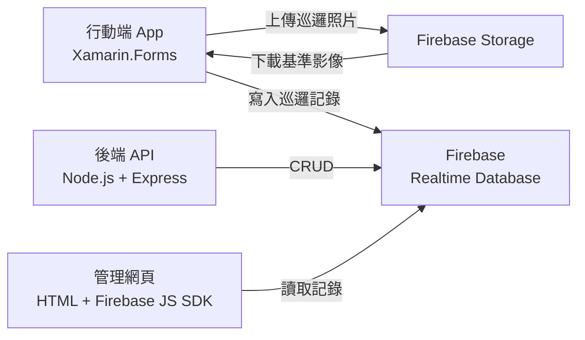

# 基於動態景物核對之智慧巡邏系統

大學畢業專題。以「現場拍照 + 影像核對」取代傳統巡邏打卡，確認巡邏人員確實抵達現場，而非只是刷過一個標籤。

## 解決什麼問題

傳統巡邏簽到多半依賴 NFC 標籤或 QR code，只能證明「有東西被掃過」，無法證明人真的在現場 —— 標籤可以被拆下帶走、QR code 可以翻拍代刷。

這套系統改成要求巡邏人員在每個巡邏點對指定景物拍照，App 當場把照片與資料庫中的基準影像比對，比對通過才算完成該點並推進巡邏進度。景物是現場環境的一部分，無法被攜帶或翻拍，因此「拍得到」等同「人在現場」。

## 系統架構



## 核心：影像核對怎麼做

程式在 `app/App1/Views/CameraViewPage.xaml.cs`，用 OpenCV for Android 實作：

1. **正規化互相關樣板比對** —— 兩張影像轉灰階後，以 `Imgproc.MatchTemplate` 搭配 `TM_CCOEFF_NORMED` 計算相似度，取最大回應值判定。選正規化版本是為了降低整體亮度變化的影響。
2. **處理尺寸與方向不一致** —— 現場拍攝的照片不會剛好等於基準圖的尺寸：
   - 若基準圖比拍攝圖大，交換兩者角色再比對
   - 若只有單邊超出（長方形對正方形），將影像旋轉 90° 後重試，仍失敗才判定無法比對
3. **逐點調整門檻** —— 不同巡邏點的標的物特徵強度差異很大，門檻依標的物分別設為 0.30 / 0.35 / 0.45，而非全域單一值。
4. **視覺回饋** —— 比對成功時在畫面上框出匹配位置，讓使用者知道系統認到的是哪個區域。

## 使用流程

選擇巡邏路線 → 進入巡邏點 → 開啟相機拍攝指定景物 → 上傳並與基準影像比對 → 通過後進度條推進至下一點 → 全部完成後顯示巡邏完成頁。

進度條是自製元件（`StepProgressBarControl.cs`），Android 端另有原生實作。

## 專案結構

| 目錄 | 說明 | 技術 |
|---|---|---|
| `app/` | 行動端 App：拍照、影像比對、巡邏進度 | Xamarin.Forms（Android / iOS / UWP） |
| `server/` | 後端 API：巡邏資料 CRUD | Node.js + Express |
| `web/` | 網頁端管理介面 | HTML + Firebase JS SDK |

三個部分共用同一個 Firebase 專案（Realtime Database + Storage）。

### `app/` 主要檔案

| 檔案 | 職責 |
|---|---|
| `Views/CameraViewPage.xaml.cs` | 相機擷取與影像比對主流程 |
| `Page1.xaml.cs` | 巡邏點清單 |
| `Finish.xaml.cs` | 巡邏完成頁 |
| `Transpoter.cs` | 頁面間狀態傳遞 |
| `StepProgressBarControl.cs` | 自製步驟進度條元件 |

## 設定

這個 repo **不包含任何 Firebase 金鑰或專案識別碼**。要執行的話需自備 Firebase 專案，並填入以下三處設定：

### 1. 行動端

```
cp app/App1/FirebaseConfig.cs.example app/App1/FirebaseConfig.cs
```

填入 `DatabaseUrl` 與 `StorageBucket`。基準影像放在 Storage 的 `patrol_dataset/<巡邏點>/<編號>.jpg`。

### 2. 後端

```
cp server/.env.example server/.env
npm install
```

填入 Firebase web config 的各欄位（Firebase Console → 專案設定 → 一般）。

### 3. 網頁端

```
cp web/.firebaserc.example web/.firebaserc
```

另外把 `web/` 底下 HTML 與 `public/init-firebase.js` 中的 `YOUR_API_KEY`、`YOUR-PROJECT-ID`、`YOUR_SENDER_ID` 換成實際值。

> **注意**：Firebase 的 web apiKey 設計上就會出現在前端原始碼中，它不是密碼。實際的存取控制請設定 Firebase 的安全性規則（Security Rules），不要依賴隱藏 apiKey。

## 已知限制

誠實記錄目前做法的邊界，也是後續可以往下做的方向：

- **樣板比對對視角與光線敏感** —— 拍攝角度偏移較多或日夜光線差異大時，相似度會明顯下降。改用特徵點比對（ORB / SIFT）或輕量級深度學習模型會更穩定。
- **門檻靠人工調參** —— 目前三組門檻是實測後手動決定的，巡邏點增加時無法擴展，應改為由資料自動決定。
- **比對在裝置端進行** —— 好處是離線可用、不必上傳原圖，但受限於手機運算能力。

## 備註

- 原始開發於 2022–2023 年，Xamarin.Forms 已由 .NET MAUI 取代。
- `web/` 底下數個 `index*.html` 為開發過程中的不同版本，`index_3.html` 為最新且功能最完整者。
